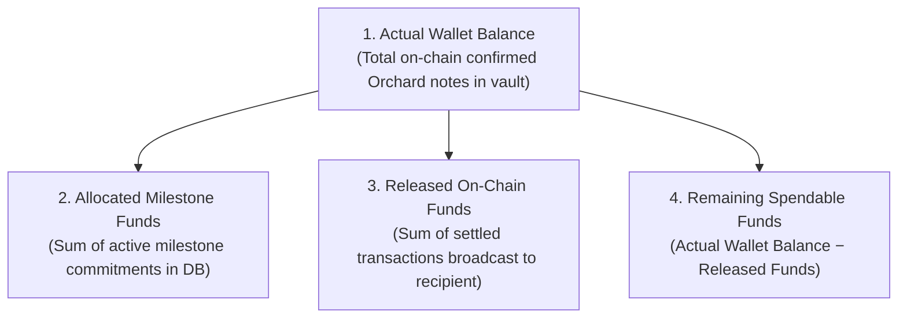

# Sentinel-Z: Escrow Security Model & Custody Architecture

## 1. Protocol Reality: Zcash Orchard vs Programmable Smart Contracts

> [!IMPORTANT]
> **Fundamental Protocol Constraint**:
> Zcash Orchard is a privacy-preserving shielded payment protocol based on zero-knowledge SNARKs (Halo 2). It is **not** an Ethereum-style virtual machine or a Turing-complete smart-contract execution environment.
>
> Sending ZEC to an Orchard address does **not** automatically lock it behind on-chain programmatic conditional logic. There are no on-chain EVM contracts, time-lock scripts, or gas-metered state machines running natively inside Orchard.

Because Orchard transactions provide unconditional transfer privacy rather than arbitrary programmatic state, any escrow system on Zcash must be built around a **rigorously defined custody and authorization model**.

---

## 2. Custody & Spending Authority

### Current Implementation: Application-Controlled Shielded Custody
In the current testnet release, Sentinel-Z operates as an **application-controlled shielded escrow vault**:
- **Key Holder**: The isolated Rust signer daemon (`crates/sentinel-zcash`) securely derives and stores the Orchard Spending Key.
- **Spending Authority**: Only the authenticated Payer (Workspace Admin) possesses the authority to grant release authorization.
- **The AI Oracle Role**: The AI verification oracle is strictly **advisory**. It has no private keys, cannot sign transactions, cannot call signer endpoints, and cannot move funds.
- **Separation of Duties**:
  - Payer: Defines milestones, funds vault, approves deliveries, authorizes settlements.
  - Recipient: Submits milestone evidence, provides Orchard Unified Address (`utest1...`).
  - Oracle: Analyzes cryptographic proof artifacts, provides schema-validated assessment.
  - Signer Daemon: Enforces mathematical invariants, checks idempotency, signs via RedPallas, broadcasts on-chain.

### Future Roadmap: Threshold Multi-Party Computation (FROST)
The architecture is designed to transition to **FROST (Flexible Round-Optimized Schnorr Threshold)** signing for RedPallas:
- A $2$-of-$3$ threshold configuration between:
  1. Payer Key Share.
  2. Recipient Key Share.
  3. Neutral Arbitrator / Platform Key Share.
- In this model, fund releases require cooperation between any two parties. Neither party nor the platform alone can unilaterally confiscate funds.

---

## 3. Financial Invariants & Fund Accounting

Sentinel-Z maintains a strict conceptual and mathematical distinction across four fund states:

| Fund Category | Meaning | Source of Truth |
|---|---|---|
| **Actual Wallet Balance** | Total confirmed shielded note commitments held by the vault's incoming viewing key. | Zcash Blockchain |
| **Allocated Milestone Funds** | Sum of commitments assigned to milestones (e.g. M1 2 ZEC, M2 3 ZEC, M3 5 ZEC = 10 ZEC). | Application Database |
| **Released Funds** | Total ZEC that has been signed with RedPallas and confirmed on-chain to the recipient. | Zcash Blockchain & TxIDs |
| **Remaining Spendable Funds** | Available unspent funds eligible for milestone settlement proposals. | Verified Calculation |

> [!WARNING]
> A database balance is **never** represented as an on-chain blockchain-enforced restriction. The application layer enforces strict mathematical checks before allowing the creation of any settlement proposal:
> $$\text{Proposal Amount} + \text{ZIP-317 Fee} \le \text{Remaining Spendable Funds}$$

---

## 4. Dispute Resolution & Refund Workflows

### Dispute Lifecycle
1. **Initiation**: If submitted milestone evidence does not meet contractual specifications, or if the counterparty fails to deliver, the Payer or Recipient can transition the escrow state to `disputed`.
2. **Freezing**: While in `disputed` status, no automated or one-sided settlement proposals can be constructed.
3. **Resolution**:
   - **Mutual Agreement**: Parties agree to revised deliverables; escrow transitions back to `in_progress`.
   - **Arbitrator Verdict**: Neutral review evaluates evidence and designates release or refund.
   - **Full or Partial Refund**: Vault constructs an Orchard transaction returning unreleased spendable funds directly to the Payer's shielded address.

