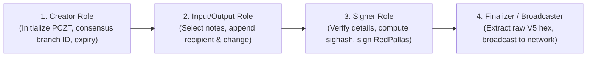

# Sentinel-Z: Transaction Construction, PCZT & Secure Signing

This document specifies the cryptographic transaction lifecycle, Partially Created Zcash Transaction (PCZT) processing, RedPallas signature generation, and network broadcasting in Sentinel-Z.

---

## 1. Zcash Transaction V5 Structure with Orchard Bundles

Sentinel-Z constructs Zcash Version 5 (V5) transactions introduced in NU5 (ZIP 225):

- **Header**:
  - `version`: `5` (V5 format).
  - `version_group_id`: `0x26A7270A`.
  - `consensus_branch_id`: `0xc2d6d0b4` (NU5).
  - `lock_time`: Unix timestamp or block height (default: `0`).
  - `expiry_height`: Current block height + 40 blocks (~50 minutes) to prevent indefinitely pending transactions.
- **Orchard Bundle**:
  - Actions containing spend descriptions (nullifiers, Merkle roots) and output descriptions (note commitments, ephemeral keys, ciphertext).
  - Value balance: Net change in zatoshi moving between the transparent/Sapling pools and the Orchard pool (for pure Orchard escrow settlements, value balance is `0` or balanced with transparent fees).
  - Flags: `SPENDS_ENABLED | OUTPUTS_ENABLED`.
  - Halo 2 Proof: Recursive proof validating spend correctness, note commitment consistency, and balance conservation without revealing notes or keys.
  - Binding Signature: Validating overall transaction balance.

---

## 2. PCZT (Partially Created Zcash Transaction) Workflow (ZIP-370)

Sentinel-Z implements the ZIP-370 standard to decouple transaction proposal from transaction signing. This architecture supports multi-party authorization, hardware wallets, and future threshold signing (FROST).



### Step 1: Proposal & Creator Role
The Creator role initializes the PCZT container with consensus branch ID `0xc2d6d0b4`, transaction version `5`, expiry height, and anchor.
```rust
let creator = Creator::new(
    consensus_branch_id,
    expiry_height,
    coin_type,
    None,
    Some(orchard_anchor),
)?;
let pczt = creator.build()?;
```

### Step 2: Input & Output Selection
The backend inspects unspent Orchard notes in the vault, selects notes sufficient to cover the milestone amount plus ZIP-317 fees, and assigns the recipient and change outputs.

### Step 3: Signer Verification
Before signing, the isolated signer executes five mandatory safety checks:
1. **Network Alignment**: Recipient address belongs to the active network (testnet `utest1...` vs mainnet `u1...`).
2. **Recipient Integrity**: Address contains a valid Orchard receiver matching the approved milestone.
3. **Amount Conservation**: Release amount does not exceed the milestone allocation.
4. **Fee Compliance**: Fee exactly matches the ZIP-317 marginal fee formula.
5. **Authorization Token**: Request carries an authorized credential.

### Step 4: RedPallas Signature Generation
Orchard spends require RedPallas signatures on the Pallas elliptic curve:
1. Compute the sighash covering all transaction components with personalization `b"ZcashOrchardSig_"`.
2. Randomize the spend authorizing key $\mathsf{ask}$ with a randomizer $\alpha \in \mathbb{F}_q$:
   $$\mathsf{rsk} = \mathsf{ask} + \alpha$$
3. Sign the sighash using RedPallas:
   $$\sigma = \text{Sign}(\mathsf{rsk}, \text{sighash})$$
4. Serialize signature to 64 bytes and attach to the Orchard spend description.

---

## 3. Replay Protection & Idempotency

Sentinel-Z implements three layers of replay defense:

1. **Idempotency Keys**:
   - Every proposal request requires a unique client-supplied idempotency key (e.g. `snz_milestone_1_attempt_1`).
   - Re-submitting the same idempotency key returns the existing proposal without creating a duplicate record or deducting additional funds.
2. **Transaction Expiry Height**:
   - Transactions are stamped with an `expiry_height`. If a transaction is not mined within 40 blocks, it becomes permanently invalid on-chain.
3. **Nullifier Uniqueness**:
   - Once an Orchard note is spent, its unique 32-byte nullifier $\mathsf{nf}$ is added to the Zcash global nullifier set. Attempting to spend the same note again is rejected by consensus rules as a double-spend attempt.

