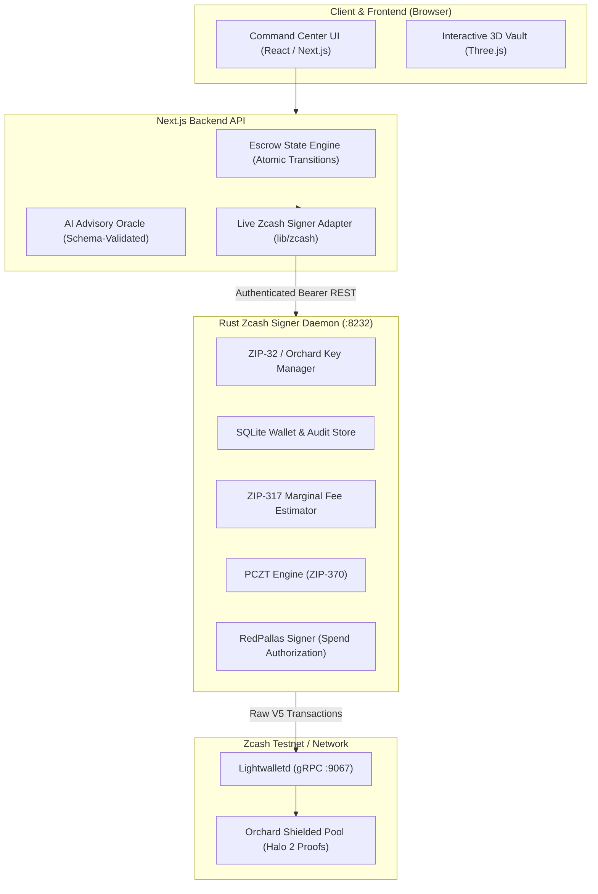
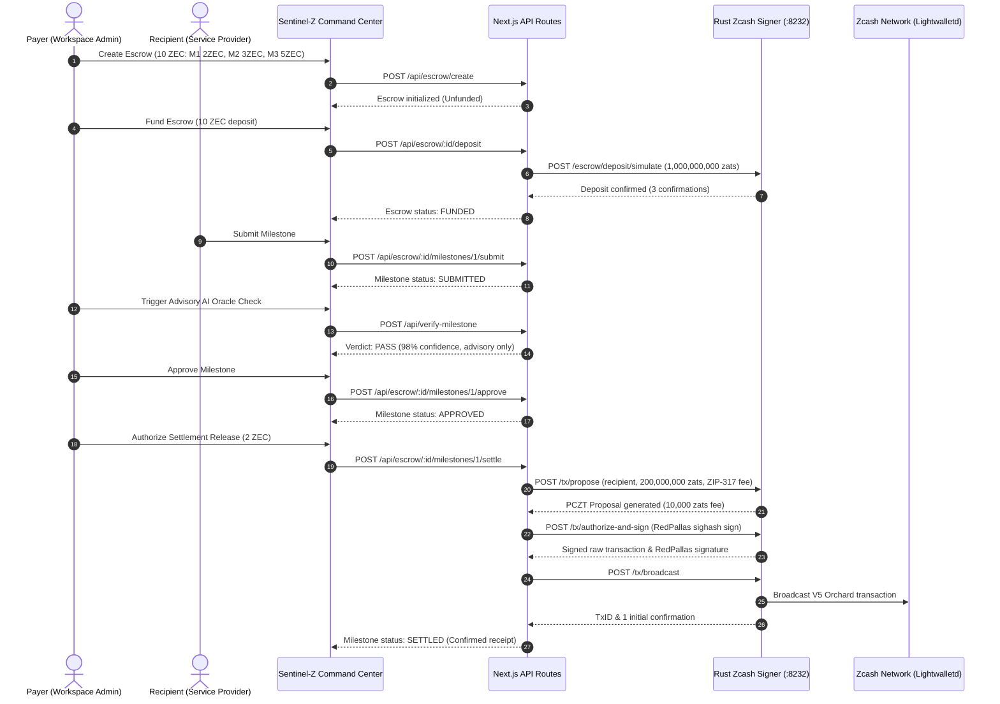

# Sentinel-Z: Zcash Architecture & Protocol Design

## Executive Summary

Sentinel-Z is an institutional-grade, privacy-preserving milestone escrow system built on the **Zcash Orchard** shielded protocol. It provides cryptographic privacy for milestone payments, advisory AI-assisted verification, and strict human authorization controls.

Unlike transparent blockchains or naive pseudonymous layers, Sentinel-Z ensures that transaction participants, transfer values, and payment notes remain confidential within the Orchard shielded pool while providing auditable, tamper-evident escrow state transitions.

---

## 1. High-Level Architecture

The architecture consists of four distinct operational boundaries:

---

## 2. Key Architectural Components

### A. The Next.js Application Layer (`app/`, `lib/escrow/`, `lib/zcash/`)
- **Interactive UI**: Responsive command center built with Tailwind CSS and React Three Fiber rendering the real-time shielded vault state.
- **Escrow State Machine**: Pure domain model enforcing valid state transitions (`unfunded` -> `funded` -> `in_progress` -> `completed` / `disputed` / `refunded`).
- **Signer Adapter Boundary (`lib/zcash/adapter.ts`)**: Strict abstraction between application logic and cryptographic operations. Refuses to fabricate transactions in client-side JavaScript.

### B. The Rust Zcash Signer Daemon (`crates/sentinel-zcash`)
- Built using official, maintained crates:
  - `orchard 0.16`: Shielded note management, RedPallas spend authorization, Orchard action builders.
  - `zcash_primitives 0.31` & `zcash_protocol 0.11`: Consensus parameters, network rules, consensus branch IDs (NU5 `0xc2d6d0b4`).
  - `zcash_keys 0.17`: Unified Address encoding/decoding and full viewing key management.
  - `pczt 0.10`: Partially Created Zcash Transaction (ZIP-370) creation and serialization.
  - `rusqlite 0.33`: WAL-mode SQLite database tracking accounts, shielded notes, proposals, and audit logs.
  - `axum 0.8` & `tokio 1.54`: Authenticated REST microservice exposing secure signing capabilities on `http://127.0.0.1:8232`.

### C. Zcash Testnet Protocol Layer
- **Orchard Shielded Pool**: Utilizes the Halo 2 zero-knowledge proving system. Spends and outputs are concealed in encrypted notes.
- **Unified Addresses (`utest1...`)**: Modern container format containing Orchard receivers, preventing accidental transparent fallback.
- **ZIP-317 Marginal Fees**: Standard marginal fee calculation (10,000 zatoshi minimum base fee) protecting against transaction censorship and resource abuse.

---

## 3. End-to-End Data Flow

---

## 4. Architectural Boundaries and Security Guarantees

1. **Isolation of Spending Keys**: Private spending keys derived via ZIP-32 reside exclusively in the Rust daemon's memory or encrypted SQLite database. Neither the frontend browser nor the Next.js API server ever inspects raw private spending keys.
2. **Explicit Authorization**: The AI Oracle is strictly advisory. An affirmative AI review has zero capability to move funds or sign transactions. Only an authenticated human payer can approve milestones and trigger the signer.
3. **Idempotency & Replay Defense**: Proposals and settlements require unique idempotency keys. Duplicate broadcasts of identical transactions or settlements for already-settled milestones are rejected at both API and database layers.

